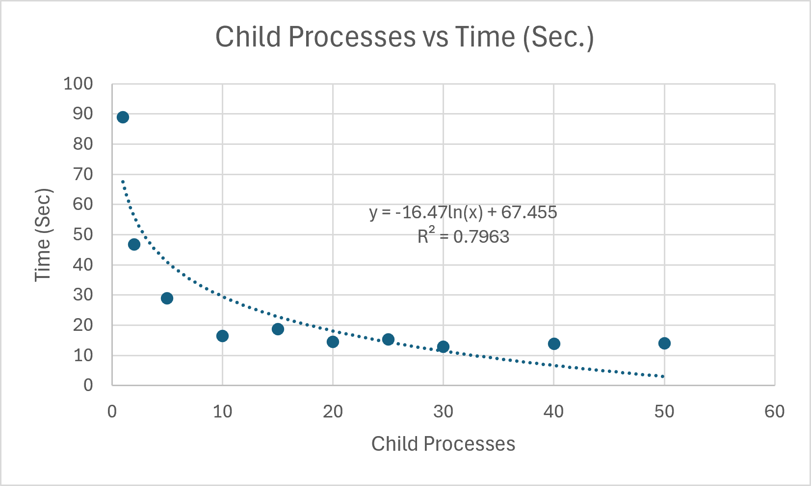

# Lab11_Multiprocessing
A small program (mandel) that creates 50 images of increasing zoom on a Mandelbrot plot.
 
**Program**
> **mandel** - Creates 50 images of a Mandelbrot plot using multiprocessing. 
> This program has two command line arguments, -c and -h. Adding -h will 
> cause the program to show its help message and immeditely exit. The -c option
> should be followed by a number, which will specify the number of child
> processes used for the creation of the images.
>  
> **Results of Multiprocessing**
> 
> The implementation within mandelmovie.c, the main file that governs this program,
> takes in a number of child processes, and will run as many processes as it can in each
> cycle of generation. If the number of children outnumbers the number of images left to be
> created, the number of children is lowered to match the remaining count. The main processes
> waits for all children to finish before creating more.
>  
> When running the file with various numbers of children, as seen in the above figure, the
> runtime decreased rapidly from 1 child process to 10 child processes, but the benefits drop
> dramatically as the number of processes increases beyond 10, bottoming off at about 13 to 15
> seconds of runtime. These results are consistent with expectations, as my machine only has a 14
> core CPU. A CPU with more available cores would likely perform even better at higher child
> counts, but that cannot be tested now.
>  
> Be sure to check out the movie made from my 50 images, **mandel.mpg**! It can be found
> in the repo with the rest of the files.